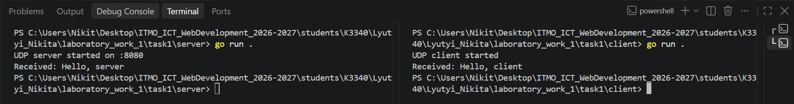
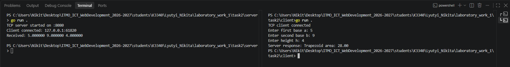
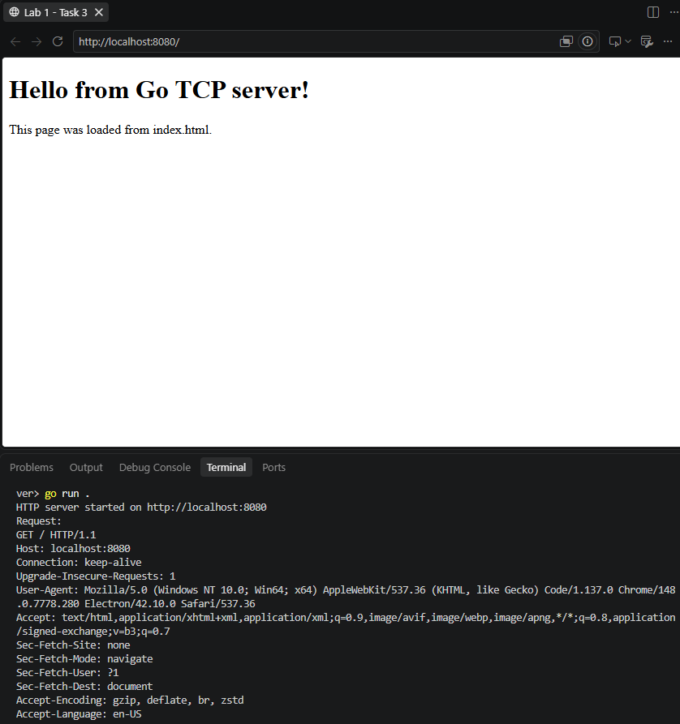
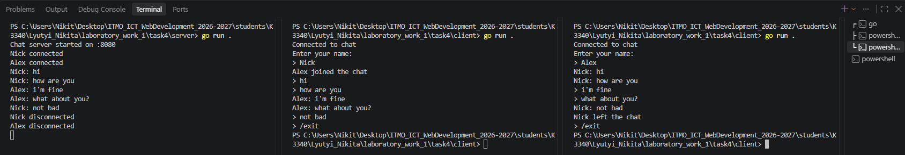
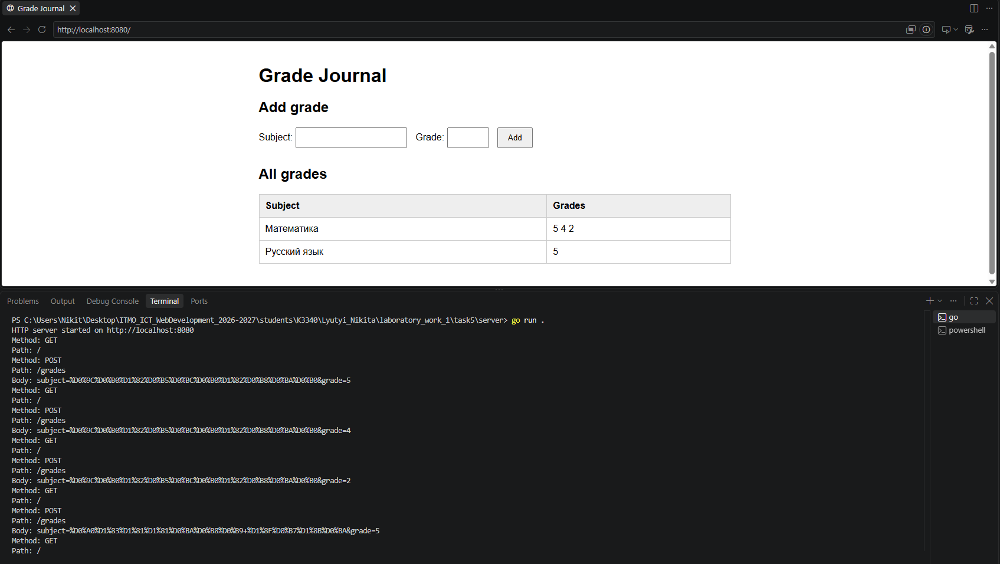

# Лабораторная работа №1. Работа с сокетами

## Цель работы

Изучить принципы клиент-серверного взаимодействия через сокеты, на практике сравнить UDP и TCP, реализовать обмен данными между клиентом и сервером, сформировать HTTP-ответ вручную и создать многопользовательский чат.

Лабораторная работа выполнена на **Go** с использованием стандартных пакетов `net`, `bufio`, `sync`, `html/template` и других пакетов стандартной библиотеки.

## Используемые протоколы

### UDP

UDP (User Datagram Protocol) — протокол без установления соединения. Данные передаются отдельными датаграммами. Доставка и порядок пакетов протоколом не гарантируются. Сервер получает не только данные, но и адрес отправителя, чтобы знать, куда отправить ответ.

В Go для UDP используются `net.ListenUDP`, `net.DialUDP`, `ReadFromUDP`, `WriteToUDP`, `Read` и `Write`.

### TCP

TCP (Transmission Control Protocol) — протокол с установлением соединения. Он гарантирует доставку байтов и сохранение их порядка. Сервер создаёт слушающий сокет через `net.Listen`, затем принимает конкретное соединение методом `Accept`. Клиент инициирует соединение с помощью `net.Dial`.

TCP передаёт **поток байтов**, а не отдельные сообщения, поэтому в заданиях для определения конца сообщения используется символ перевода строки `\n`.

### HTTP

HTTP работает поверх TCP. HTTP-запрос и ответ состоят из стартовой строки, заголовков, пустой строки и, при необходимости, тела сообщения. В заданиях 3 и 5 HTTP реализован вручную поверх TCP без использования `net/http`.

## Задание 1. Обмен сообщениями по UDP

### Описание

UDP-сервер запускается на порту `8080` и ожидает датаграмму. Клиент отправляет сообщение `Hello, server`. Сервер выводит полученное сообщение и отвечает `Hello, client` на адрес отправителя.

### Клиент

```go
package main

import (
	"fmt"
	"log"
	"net"
)

func main() {
	serverAddr, err := net.ResolveUDPAddr("udp", "127.0.0.1:8080")
	if err != nil {
		log.Fatal(err)
	}

	conn, err := net.DialUDP("udp", nil, serverAddr)
	if err != nil {
		log.Fatal(err)
	}
	defer conn.Close()

	fmt.Println("UDP client started")

	msg := []byte("Hello, server")

	_, err = conn.Write(msg)
	if err != nil {
		log.Fatal(err)
	}

	buffer := make([]byte, 1024)

	n, err := conn.Read(buffer)
	if err != nil {
		log.Fatal(err)
	}

	fmt.Println("Received:", string(buffer[:n]))
}
```

### Сервер

```go
package main

import (
	"fmt"
	"log"
	"net"
)

func main() {
	addr, err := net.ResolveUDPAddr("udp", ":8080")
	if err != nil {
		log.Fatal(err)
	}

	conn, err := net.ListenUDP("udp", addr)
	if err != nil {
		log.Fatal(err)
	}
	defer conn.Close()

	fmt.Println("UDP server started on :8080")

	buffer := make([]byte, 1024)

	n, clientAddr, err := conn.ReadFromUDP(buffer)
	if err != nil {
		log.Fatal(err)
	}

	fmt.Println("Received:", string(buffer[:n]))

	msg := []byte("Hello, client")

	_, err = conn.WriteToUDP(msg, clientAddr)
	if err != nil {
		log.Fatal(err)
	}
}
```

### Пример работы

```text
# server
go run .
UDP server started on :8080
Received: Hello, server

# client
go run .
UDP client started
Received: Hello, client
```




## Задание 2. Вычисления через TCP

### Описание

По номеру в журнале используется вариант 3 - вычисление площади трапеции:

**S = ((a + b) / 2) · h**

Клиент устанавливает TCP-соединение с сервером, считывает основания `a`, `b` и высоту `h`, передаёт их серверу одной строкой. Сервер извлекает значения, вычисляет площадь и возвращает результат клиенту.

### Клиент

```go
package main

import (
	"bufio"
	"fmt"
	"log"
	"net"
)

func main() {
	conn, err := net.Dial("tcp", "127.0.0.1:8080")
	if err != nil {
		log.Fatal(err)
	}
	defer conn.Close()

	fmt.Println("TCP client connected")

	var a, b, h float64

	fmt.Print("Enter first base a: ")
	fmt.Scan(&a)

	fmt.Print("Enter second base b: ")
	fmt.Scan(&b)

	fmt.Print("Enter height h: ")
	fmt.Scan(&h)

	msg := fmt.Sprintf("%f %f %f\n", a, b, h)

	msgByte := []byte(msg)

	_, err = conn.Write(msgByte)
	if err != nil {
		log.Fatal(err)
	}

	reader := bufio.NewReader(conn)

	response, err := reader.ReadString('\n')
	if err != nil {
		log.Fatal(err)
	}

	fmt.Print("Server response: ", response)
}
```

### Сервер

```go
package main

import (
	"bufio"
	"fmt"
	"log"
	"net"
)

func main() {
	listener, err := net.Listen("tcp", ":8080")
	if err != nil {
		log.Fatal(err)
	}

	defer listener.Close()

	fmt.Println("TCP server started on :8080")

	conn, err := listener.Accept()
	if err != nil {
		log.Fatal(err)
	}
	defer conn.Close()

	fmt.Println("Client connected:", conn.RemoteAddr())

	reader := bufio.NewReader(conn)

	msg, err := reader.ReadString('\n')
	if err != nil {
		log.Fatal(err)
	}

	fmt.Println("Received:", msg)

	var a, b, h float64

	_, err = fmt.Sscanf(msg, "%f %f %f", &a, &b, &h)
	if err != nil {
		log.Fatal(err)
	}

	area := (a + b) / 2 * h

	response := fmt.Sprintf("Trapezoid area: %.2f\n", area)

	responseByte := []byte(response)
	_, err = conn.Write(responseByte)
	if err != nil {
		log.Fatal(err)
	}
}
```

### Пример работы

```text
# server
TCP server started on :8080
Client connected: 127.0.0.1:50748
Received: 5.000000 9.000000 4.000000

# client
TCP client connected
Enter first base a: 5
Enter second base b: 9
Enter height h: 4
Server response: Trapezoid area: 28.00
```



## Задание 3. Раздача HTML-страницы по HTTP

### Описание

Сервер принимает TCP-соединение от браузера, читает HTTP-запрос, загружает страницу из файла `index.html` и вручную формирует HTTP-ответ со статусом `200 OK`, заголовками `Content-Type` и `Content-Length`.

Структура HTTP-ответа:

```text
HTTP/1.1 200 OK
Content-Type: text/html; charset=utf-8
Content-Length: ...

<html>...</html>
```

### Сервер

```go
package main

import (
	"fmt"
	"log"
	"net"
	"os"
)

func handleConnection(conn net.Conn) {
	defer conn.Close()
	buffer := make([]byte, 4096)

	n, err := conn.Read(buffer)
	if err != nil {
		log.Fatal(err)
		return
	}

	request := string(buffer[:n])

	fmt.Println("Request:")
	fmt.Println(request)

	html, err := os.ReadFile("index.html")
	if err != nil {
		log.Fatal(err)
		return
	}

	response := fmt.Sprintf(
		"HTTP/1.1 200 OK\r\n"+
			"Content-Type: text/html; charset=utf-8\r\n"+
			"Content-Length: %d\r\n"+
			"\r\n"+
			"%s",
		len(html),
		html,
	)

	_, err = conn.Write([]byte(response))
	if err != nil {
		log.Fatal(err)
		return
	}
}

func main() {
	listener, err := net.Listen("tcp", ":8080")
	if err != nil {
		log.Fatal(err)
	}
	defer listener.Close()

	fmt.Println("HTTP server started on http://localhost:8080")

	for {
		conn, err := listener.Accept()
		if err != nil {
			log.Println(err)
			continue
		}
		handleConnection(conn)
	}

}
```

### HTML-страница

```html
<!DOCTYPE html>
<html lang="en">
<head>
    <meta charset="UTF-8">
    <title>Lab 1 - Task 3</title>
</head>
<body>
    <h1>Hello from Go TCP server!</h1>
    <p>This page was loaded from index.html.</p>
</body>
</html>
```

### Пример работы

В терминале сервера отображается запрос браузера:

```text
HTTP server started on http://localhost:8080
Request:
GET / HTTP/1.1
Host: localhost:8080
...
```

В браузере отображается содержимое `index.html`.




## Задание 4. Многопользовательский чат на TCP

### Описание

Сервер принимает несколько TCP-подключений одновременно. Для каждого клиента запускается отдельная goroutine. Каждый пользователь вводит имя, после чего сервер хранит активных пользователей в структуре `Client` и общей `map`.

Для защиты общей `map` от одновременного доступа из нескольких goroutine используется `sync.Mutex`. Функция `broadcast` рассылает сообщение всем подключённым клиентам, кроме отправителя. Команда `/exit` завершает соединение пользователя и удаляет его из списка активных клиентов.

Клиент также использует отдельную goroutine для одновременного чтения входящих сообщений и ввода с клавиатуры.

### Клиент

```go
package main

import (
	"bufio"
	"fmt"
	"log"
	"net"
	"os"
	"strings"
)

func receiveMessages(conn net.Conn) {
	reader := bufio.NewReader(conn)

	for {
		msg, err := reader.ReadString('\n')
		if err != nil {
			log.Println("\nDisconnected from server")
			os.Exit(0)
		}

		fmt.Printf("\r%s> ", msg)
	}
}

func main() {
	conn, err := net.Dial("tcp", "127.0.0.1:8080")
	if err != nil {
		log.Fatal(err)
	}
	defer conn.Close()

	fmt.Println("Connected to chat")

	go receiveMessages(conn)

	reader := bufio.NewReader(os.Stdin)

	for {
		fmt.Print("> ")

		msg, err := reader.ReadString('\n')
		if err != nil {
			log.Fatal(err)
		}

		_, err = conn.Write([]byte(msg))
		if err != nil {
			log.Fatal(err)
		}

		if strings.TrimSpace(msg) == "/exit" {
			return
		}
	}
}
```

### Сервер

```go
package main

import (
	"bufio"
	"fmt"
	"log"
	"net"
	"strings"
	"sync"
)

type Client struct {
	name string
	conn net.Conn
}

var clients = make(map[net.Conn]*Client)
var mutex sync.Mutex

func broadcast(msg string, sender net.Conn) {
	mutex.Lock()
	defer mutex.Unlock()

	for _, client := range clients {
		if client.conn == sender {
			continue
		}

		_, err := client.conn.Write([]byte(msg))
		if err != nil {
			log.Println("Error sending message to ", client.name, " : ", err)
		}
	}
}

func handleConn(conn net.Conn) {
	defer conn.Close()

	reader := bufio.NewReader(conn)

	_, err := conn.Write([]byte("Enter your name: \n"))
	if err != nil {
		log.Println(err)
		return
	}

	name, err := reader.ReadString('\n')
	if err != nil {
		log.Println(err)
		return
	}

	name = strings.TrimSpace(name)

	client := &Client{
		name: name,
		conn: conn,
	}

	mutex.Lock()
	clients[conn] = client
	mutex.Unlock()

	fmt.Println(name, "connected")

	broadcast(
		fmt.Sprintf("%s joined the chat\n", name),
		conn,
	)

	for {
		msg, err := reader.ReadString('\n')
		if err != nil {
			break
		}

		msg = strings.TrimSpace(msg)

		if msg == "" {
			continue
		}

		if msg == "/exit" {
			break
		}

		fmt.Printf("%s: %s\n", name, msg)

		broadcast(
			fmt.Sprintf("%s: %s\n", name, msg),
			conn,
		)
	}

	mutex.Lock()
	delete(clients, conn)
	mutex.Unlock()

	fmt.Println(name, "disconnected")

	broadcast(
		fmt.Sprintf("%s left the chat\n", name),
		conn,
	)
}

func main() {
	listener, err := net.Listen("tcp", ":8080")
	if err != nil {
		log.Fatal(err)
	}
	defer listener.Close()

	fmt.Println("Chat server started on :8080")

	for {
		conn, err := listener.Accept()
		if err != nil {
			log.Println(err)
			continue
		}

		go handleConn(conn)
	}
}
```

### Пример работы

```text
# server
Chat server started on :8080
Nick connected
Alex connected
Nick: Hello
Alex: hi
Nick: how are you
Alex: fine, thx
Alex disconnected
Nick disconnected
```

Пример диалога клиента `Nick`:

```text
Connected to chat
Enter your name:
> Nick
Alex joined the chat
> Hello
Alex: hi
> how are you
Alex: fine, thx
Alex left the chat
> /exit
```



---

## Задание 5. Простой HTTP-сервер с GET и POST

### Описание

Реализован простой HTTP-сервер без `net/http`. Сервер вручную разбирает:

- request line (`GET / HTTP/1.1`, `POST /grades HTTP/1.1`);
- HTTP-заголовки;
- `Content-Length`;
- тело POST-запроса.

Журнал хранится в структуре:

```go
map[string][]int
```

где ключ - название дисциплины, а значение - список оценок. Поэтому несколько оценок одного предмета группируются в одной записи.

HTML вынесен в отдельный файл `index.html` и обрабатывается через `html/template`. При отправке формы браузер выполняет `POST /grades`, после сохранения данных сервер отвечает `303 See Other` с заголовком `Location: /`. Браузер затем автоматически выполняет `GET /` и получает обновлённую страницу. Используется схема **Post/Redirect/Get**.

### Сервер

```go
package main

import (
	"bufio"
	"bytes"
	"fmt"
	"html/template"
	"io"
	"log"
	"net"
	"net/url"
	"strconv"
	"strings"
	"sync"
)

type Request struct {
	Method  string
	Path    string
	Headers map[string]string
	Body    string
}

type PageData struct {
	Grades map[string][]int
}

var grades = make(map[string][]int)
var mutex sync.Mutex

func parseRequest(reader *bufio.Reader) (*Request, error) {
	requestLine, err := reader.ReadString('\n')
	if err != nil {
		return nil, err
	}

	requestLine = strings.TrimSpace(requestLine)

	parts := strings.Split(requestLine, " ")
	if len(parts) != 3 {
		return nil, fmt.Errorf("invalid request line")
	}

	request := &Request{
		Method:  parts[0],
		Path:    parts[1],
		Headers: make(map[string]string),
	}

	for {
		line, err := reader.ReadString('\n')
		if err != nil {
			return nil, err
		}

		if line == "\r\n" {
			break
		}

		line = strings.TrimSpace(line)

		headerParts := strings.SplitN(line, ":", 2)
		if len(headerParts) != 2 {
			continue
		}

		key := strings.TrimSpace(headerParts[0])
		value := strings.TrimSpace(headerParts[1])

		request.Headers[key] = value
	}

	contentLength := 0

	if val, ok := request.Headers["Content-Length"]; ok {
		contentLength, err = strconv.Atoi(val)
		if err != nil {
			return nil, fmt.Errorf("invalid Content-Length")
		}
	}

	if contentLength > 0 {
		body := make([]byte, contentLength)

		_, err := io.ReadFull(reader, body)
		if err != nil {
			return nil, err
		}

		request.Body = string(body)
	}

	return request, nil
}

func sendResponse(
	conn net.Conn,
	status string,
	contentType string,
	body string,
	extraHeaders map[string]string,
) {
	response := fmt.Sprintf(
		"HTTP/1.1 %s\r\n"+
			"Content-Type: %s\r\n"+
			"Content-Length: %d\r\n",
		status,
		contentType,
		len([]byte(body)),
	)

	for key, val := range extraHeaders {
		response += fmt.Sprintf("%s: %s\r\n", key, val)
	}

	response += "\r\n"
	response += body

	_, err := conn.Write([]byte(response))
	if err != nil {
		log.Println("Error sending response:", err)
	}
}

func renderPage() (string, error) {
	tmpl, err := template.ParseFiles("index.html")
	if err != nil {
		return "", err
	}

	mutex.Lock()

	data := PageData{
		Grades: grades,
	}

	var body bytes.Buffer

	err = tmpl.Execute(&body, data)

	mutex.Unlock()

	if err != nil {
		return "", err
	}

	return body.String(), nil
}

func handleGet(conn net.Conn, requst *Request) {
	if requst.Path != "/" {
		sendResponse(
			conn,
			"404 Not Found",
			"text/plain; charset=utf-8",
			"404 Not Found",
			nil,
		)
		return
	}

	page, err := renderPage()
	if err != nil {
		log.Println("Template error:", err)

		sendResponse(
			conn,
			"500 Internal Server Error",
			"text/plain; charset=utf-8",
			"Internal Server Error",
			nil,
		)

		return
	}

	sendResponse(
		conn,
		"200 OK",
		"text/html; charset=utf-8",
		page,
		nil,
	)
}

func handlePost(conn net.Conn, request *Request) {
	if request.Path != "/grades" {
		sendResponse(
			conn,
			"404 Not Found",
			"text/plain; charset=utf-8",
			"404 Not Found",
			nil,
		)
		return
	}

	values, err := url.ParseQuery(request.Body)
	if err != nil {
		sendResponse(
			conn,
			"400 Bad Request",
			"text/plain; charset=utf-8",
			"Invalid form data",
			nil,
		)
		return
	}

	subject := strings.TrimSpace(values.Get("subject"))
	gradeString := values.Get("grade")

	if subject == "" {
		sendResponse(
			conn,
			"400 Bad Request",
			"text/plain; charset=utf-8",
			"Subject is required",
			nil,
		)
		return
	}

	grade, err := strconv.Atoi(gradeString)
	if err != nil || grade < 2 || grade > 5 {
		sendResponse(
			conn,
			"400 Bad Request",
			"text/plain; charset=utf-8",
			"Grade must be an integer from 2 to 5",
			nil,
		)
		return
	}

	mutex.Lock()
	grades[subject] = append(grades[subject], grade)
	mutex.Unlock()

	sendResponse(
		conn,
		"303 See Other",
		"text/plain; charset=utf-8",
		"",
		map[string]string{
			"Location": "/",
		},
	)
}

func handleConnection(conn net.Conn) {
	defer conn.Close()

	reader := bufio.NewReader(conn)

	request, err := parseRequest(reader)
	if err != nil {
		log.Println("Error parsing request:", err)
		return
	}

	fmt.Println("Method:", request.Method)
	fmt.Println("Path:", request.Path)

	if request.Body != "" {
		fmt.Println("Body:", request.Body)
	}

	switch request.Method {
	case "GET":
		handleGet(conn, request)
	case "POST":
		handlePost(conn, request)

	default:
		sendResponse(
			conn,
			"405 Method Not Allowed",
			"text/plain; charset=utf-8",
			"Method Not Allowed",
			nil,
		)
	}
}

func main() {
	listener, err := net.Listen("tcp", ":8080")
	if err != nil {
		log.Fatal(err)
	}
	defer listener.Close()

	fmt.Println("HTTP server started on http://localhost:8080")

	for {
		conn, err := listener.Accept()
		if err != nil {
			log.Println(err)
			continue
		}

		go handleConnection(conn)
	}
}
```

### HTML-шаблон

```html
<!DOCTYPE html>
<html lang="en">
<head>
    <meta charset="UTF-8">
    <title>Grade Journal</title>

    <style>
        body {
            font-family: Arial, sans-serif;
            max-width: 800px;
            margin: 40px auto;
        }

        form {
            margin-bottom: 30px;
        }

        input {
            padding: 8px;
            margin-right: 10px;
        }

        button {
            padding: 8px 16px;
        }

        table {
            border-collapse: collapse;
            width: 100%;
        }

        th,
        td {
            border: 1px solid #ccc;
            padding: 10px;
            text-align: left;
        }

        th {
            background: #eee;
        }
    </style>
</head>

<body>

<h1>Grade Journal</h1>

<h2>Add grade</h2>

<form method="POST" action="/grades">
    <label>
        Subject:
        <input
            type="text"
            name="subject"
            required
        >
    </label>

    <label>
        Grade:
        <input
            type="number"
            name="grade"
            min="2"
            max="5"
            required
        >
    </label>

    <button type="submit">
        Add
    </button>
</form>

<h2>All grades</h2>

{{if .Grades}}

<table>
    <tr>
        <th>Subject</th>
        <th>Grades</th>
    </tr>

    {{range $subject, $grades := .Grades}}
    <tr>
        <td>{{$subject}}</td>

        <td>
            {{range $grade := $grades}}
                {{$grade}}
            {{end}}
        </td>
    </tr>
    {{end}}
</table>

{{else}}

<p>No grades yet.</p>

{{end}}

</body>
</html>
```

### Пример HTTP-взаимодействия

```text
HTTP server started on http://localhost:8080
Method: GET
Path: /
Method: POST
Path: /grades
Body: subject=%D0%BC%D0%B0%D1%82&grade=2
Method: GET
Path: /
Method: POST
Path: /grades
Body: subject=%D0%BC%D0%B0%D1%82++&grade=5
Method: GET
Path: /
```

Последовательность после добавления оценки:

```text
POST /grades
      ↓
сохранение оценки
      ↓
303 See Other
Location: /
      ↓
GET /
      ↓
обновлённый журнал
```



## Вывод

В ходе лабораторной работы были реализованы UDP- и TCP-клиенты и серверы на Go, изучены различия между датаграммным и потоковым взаимодействием, реализовано формирование HTTP-ответа вручную, многопользовательский TCP-чат с конкурентной обработкой подключений и простой HTTP-сервер с GET/POST-запросами и динамическим HTML-шаблоном.
