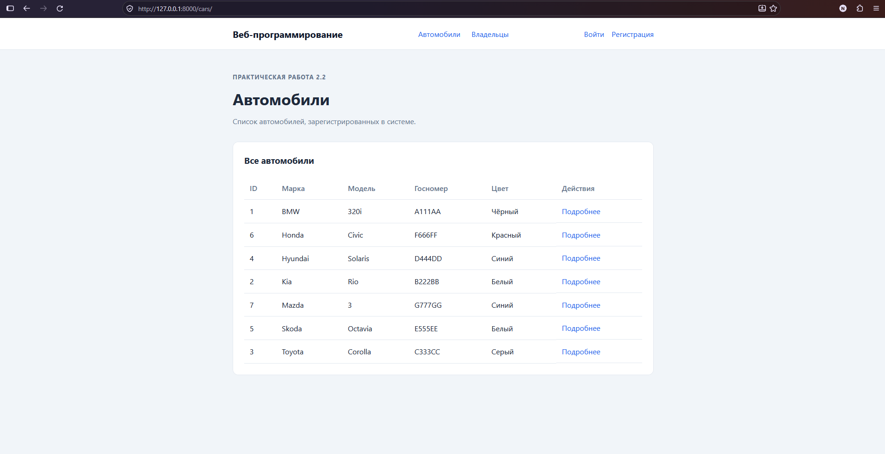
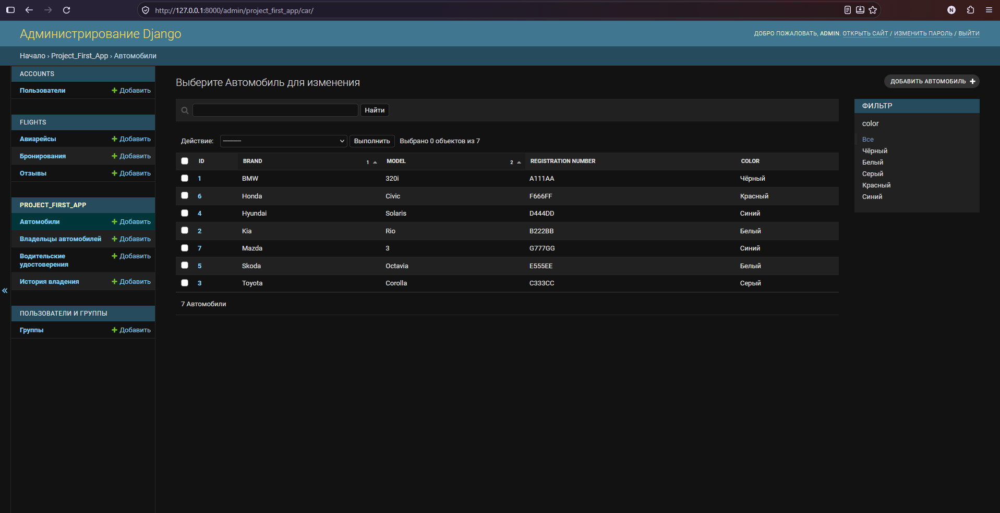
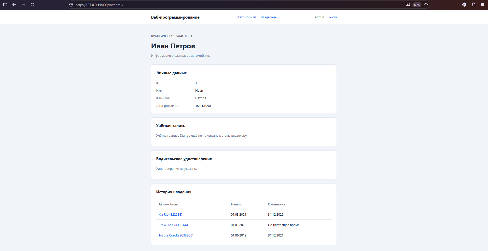
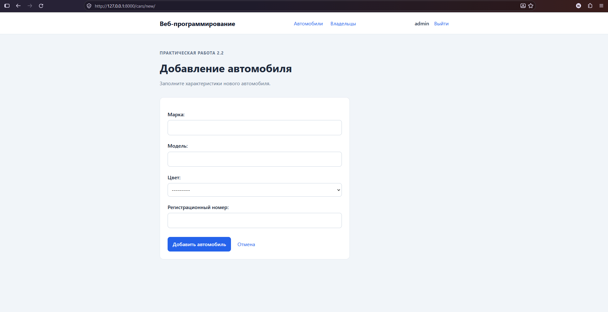
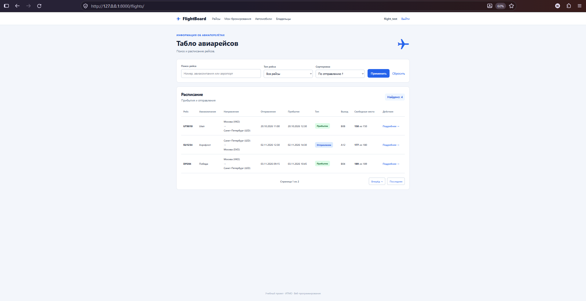
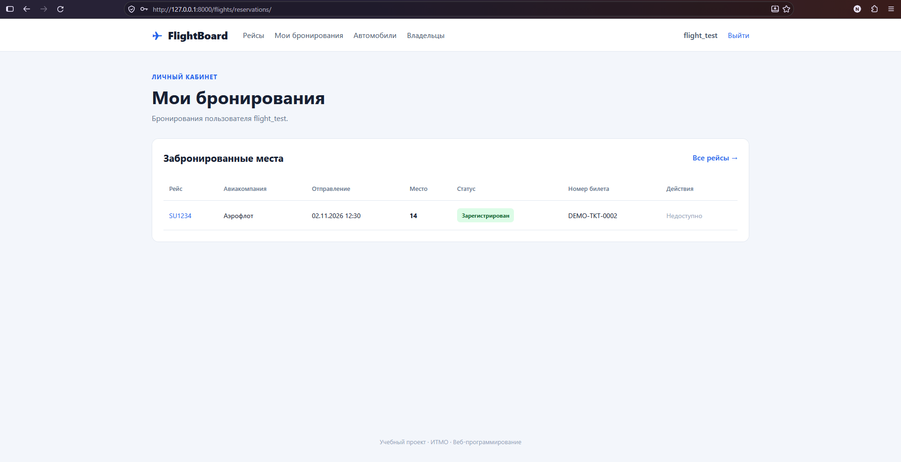
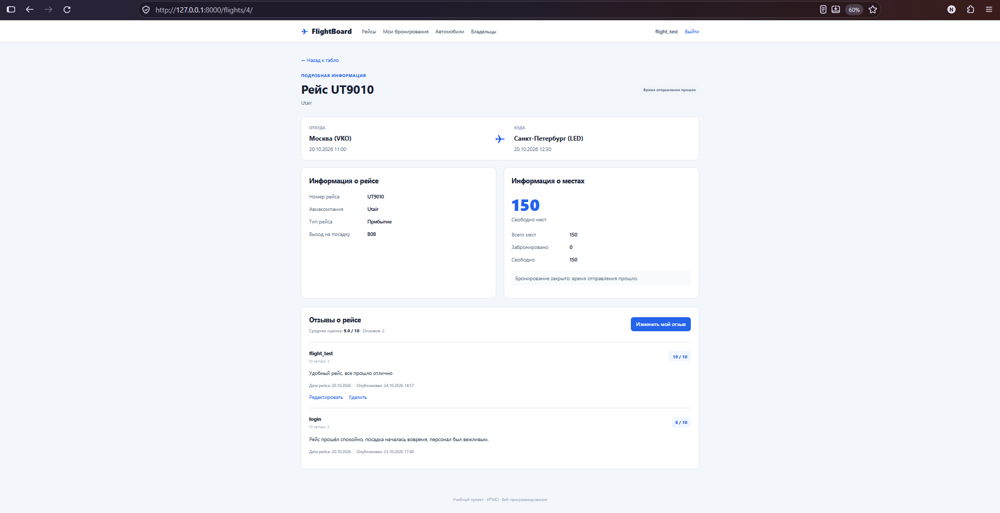
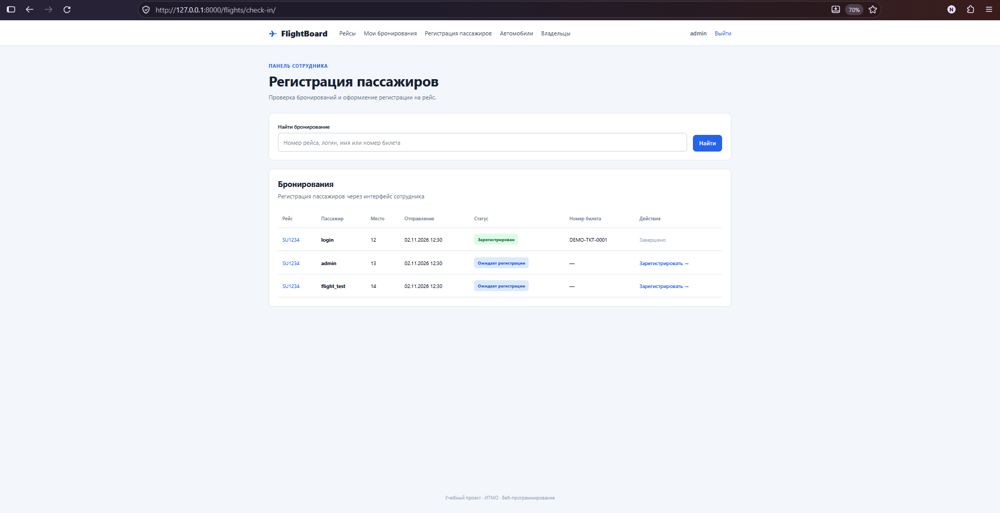
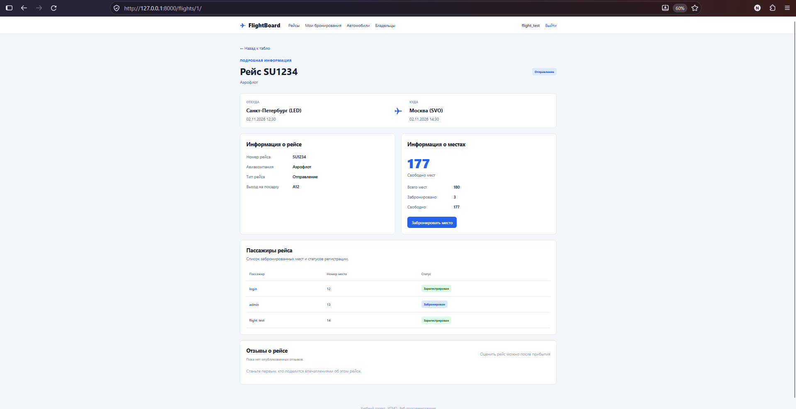
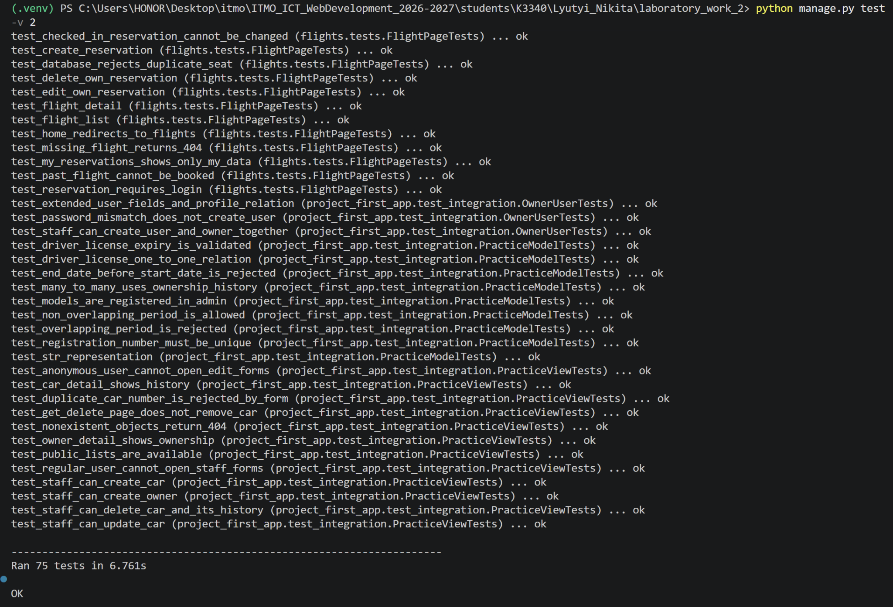

# Лабораторная работа №2. Разработка веб-приложения на Django

**Дисциплина:** Веб-программирование  
**Студент:** Лютый Никита  
**Группа:** K3340  
**Вариант:** №3 — Табло авиаперелётов

## 1. Цель и постановка задачи

Изучить возможности Django 3, работу с PostgreSQL через ORM, модели данных и связи между ними, Django Admin, формы, маршрутизацию, функциональные и классовые представления, авторизацию и создание пользовательского интерфейса.

Работа состоит из практических заданий 2.1–2.3 и индивидуального варианта №3. Практическая часть посвящена автомобилям и владельцам, индивидуальная — информационной системе авиаперелётов.

**Используемые технологии:** Python 3.10.11, Django 3.2.25, PostgreSQL 16, Docker Compose, Jinja2 3.1.6, HTML5 и CSS3.

## 2. Архитектура приложения

Приложение разработано по архитектуре **MVT (Model–View–Template)**:

- **Model:** модели ORM описывают сущности и ограничения базы данных.
- **View:** FBV/CBV принимают запросы, работают с ORM и формируют контекст.
- **Template:** HTML-шаблоны Django и Jinja2 отображают данные.

В проект входят три Django-приложения:

| Приложение | Назначение |
| --- | --- |
| `project_first_app` | Владельцы, автомобили, водительские удостоверения, история владения |
| `accounts` | Пользователь `AbstractUser`, регистрация, вход/выход |
| `flights` | Рейсы, бронирования, отзывы и регистрация пассажиров |

Конфигурация проекта — `django_project_lyutyi`. Данные хранятся в PostgreSQL; параметры подключения задаются через `.env`.

## 3. Практическая работа 2.1 — модели и администрирование

Созданы модели:

| Модель | Основные поля и связи |
| --- | --- |
| `CarOwner` | Имя, фамилия, дата рождения |
| `Car` | Марка, модель, цвет, уникальный госномер |
| `DriverLicense` | Номер, дата выдачи, срок действия; `OneToOne` с владельцем |
| `Ownership` | Автомобиль, владелец, дата начала и окончания владения |

Связь автомобиля и владельца реализована как **Many-to-Many через `Ownership`**. Это позволяет одному человеку владеть несколькими машинами, а одной машине — иметь разных владельцев в различные периоды. Валидация предотвращает некорректные даты и пересечения периодов владения одним автомобилем.

Модели зарегистрированы в Django Admin; настроены списки, фильтры и формы редактирования. Сформированы демонстрационные данные с несколькими владельцами, автомобилями и периодами владения. Создана публичная страница владельца по его ID.



*Рисунок 1 — список автомобилей.*



*Рисунок 2 — управление историей владения в Django Admin.*

## 4. Практическая работа 2.2 — формы и CRUD

Реализованы функциональные представления (**FBV**) для списка, карточки и создания владельцев, а также классовые представления (**CBV**) для автомобилей: список, карточка, создание, изменение и удаление.

HTML-формы используют серверную валидацию. Перед удалением автомобиля выводится страница подтверждения. Операции изменения данных защищены проверками прав доступа.



*Рисунок 3 — карточка владельца и связанные автомобили.*



*Рисунок 4 — форма создания автомобиля.*

## 5. Практическая работа 2.3 — расширение User

Для работы с пользователями создана модель `accounts.User` на основе `AbstractUser`. Добавлены поля **номера паспорта, домашнего адреса и национальности**. Пользователь может быть связан с профилем `CarOwner` через `OneToOneField`.

Реализована форма создания пользовательской записи со связанным владельцем, предусмотрена проверка совпадения паролей. Наличие расширенных полей и корректность создания профиля проверяются автоматическими тестами.

## 6. Индивидуальный вариант №3 — FlightBoard

### 6.1. Модели

- `Flight` — номер и тип рейса, авиакомпания, аэропорты и время отправления/прибытия, выход на посадку, вместимость.
- `Reservation` — пользователь, рейс, место, статус регистрации, номер билета.
- `Review` — рейс, автор, дата рейса, текст и оценка от 1 до 10.

На уровне базы данных заданы ограничения: уникальность места в одном рейсе, уникальность номера билета, один отзыв автора на конкретный рейс, допустимый диапазон оценок и положительная вместимость.

### 6.2. Табло, поиск и пагинация

На странице `/flights/` отображаются прибытия и отправления. Реализован поиск по номеру рейса, авиакомпании, аэропорту отправления или назначения, фильтр по типу, сортировка и пагинация. Количество свободных мест рассчитывается на основе бронирований через ORM `annotate()`.



*Рисунок 5 — табло рейсов с поиском, фильтрами и пагинацией.*

### 6.3. Бронирование мест

После входа пользователь выбирает свободное место и создаёт бронь. В личном кабинете можно изменить место или отменить бронь, пока рейс не отправился и пассажир не зарегистрирован. Занять одно место дважды нельзя: ограничения проверяются в форме и PostgreSQL. Для связанных изменений применяются транзакции.



*Рисунок 6 — личный кабинет пользователя.*

### 6.4. Отзывы об авиарейсах

Отзыв можно опубликовать после прибытия рейса. Пользователь указывает текст и оценку 1–10, может редактировать и удалять только свой отзыв. На странице рейса выводятся отзывы и средняя оценка, вычисленная через `Avg()`. Повторное создание отзыва тем же автором ограничено базой данных.



*Рисунок 7 — отзывы об авиарейсе и средняя оценка.*

### 6.5. Регистрация пассажиров сотрудником

Сотрудник с `is_staff=True` получает доступ к `/flights/check-in/`. Он находит бронирование по логину, рейсу или номеру билета, назначает билет и переводит бронь в статус «Зарегистрирован». Изменение статуса и номера билета выполняется совместно в транзакции.

Обычному пользователю служебный интерфейс недоступен. Публичный список пассажиров на странице рейса показывает место и статус, но не номер билета. После регистрации пассажир не может самостоятельно изменить или отменить бронь.



*Рисунок 8 — панель регистрации пассажиров.*



*Рисунок 9 — открытая информация о пассажирах и статусах регистрации.*

### 6.6. Адаптивная вёрстка

Сайт использует HTML5 и CSS3: карточки, таблицы, формы, фильтры и мобильную навигацию. На узких экранах формы размещаются вертикально, а таблицы прокручиваются горизонтально.


*Рисунок 10 — мобильное отображение интерфейса.*

## 7. Тестирование

Тесты написаны на `django.test.TestCase` и используют отдельную тестовую PostgreSQL-базу. Проверены модели и ограничения, формы, маршруты, права доступа, создание/изменение/удаление записей и корректность поиска.

| Набор проверок | Количество |
| --- | ---: |
| Регистрация и авторизация (`accounts`) | 4 |
| Авиарейсы и бронирование (`flights.tests`) | 15 |
| Отзывы (`flights.test_reviews`) | 10 |
| Регистрация пассажиров (`flights.test_checkin`) | 11 |
| Поиск и пагинация (`flights.test_listing`) | 11 |
| Практики 2.1–2.3 (`project_first_app.test_integration`) | 24 |
| **Всего** | **75** |

```powershell
python manage.py check
python manage.py makemigrations --check --dry-run
python manage.py test -v 2
```

**Результат 24 октября 2026 года:** `Ran 75 tests in 6.761s`, `OK`; Django System Check — 0 ошибок; изменений моделей, требующих миграции, нет.



*Рисунок 11 — успешный полный прогон тестов.*

## 8. Выводы

В лабораторной работе освоены компоненты архитектуры MVT, Django ORM, формы, FBV/CBV, Django Admin, авторизация и работа с PostgreSQL. Реализованы практические задания 2.1–2.3 и веб-приложение по варианту №3. Настроены проверки целостности данных, прав доступа и автоматическое тестирование. Полный прогон **75 тестов завершился успешно**.

Исходный код и инструкция запуска находятся в каталоге `students/K3340/Lyutyi_Nikita/laboratory_work_2/README.md`.
