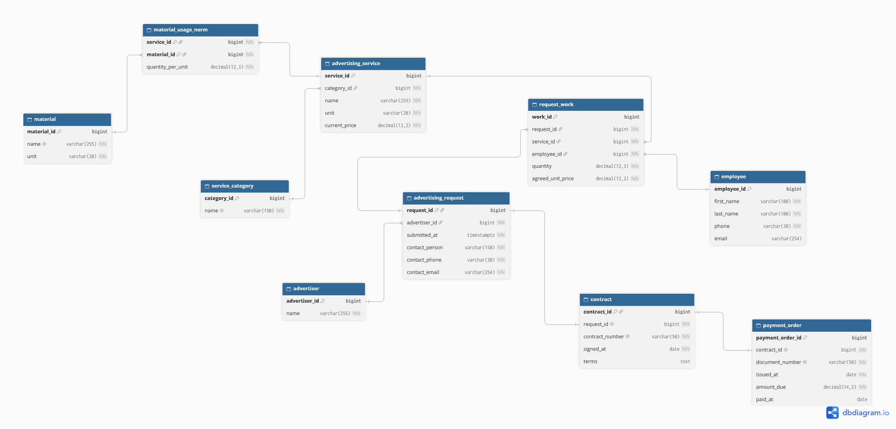
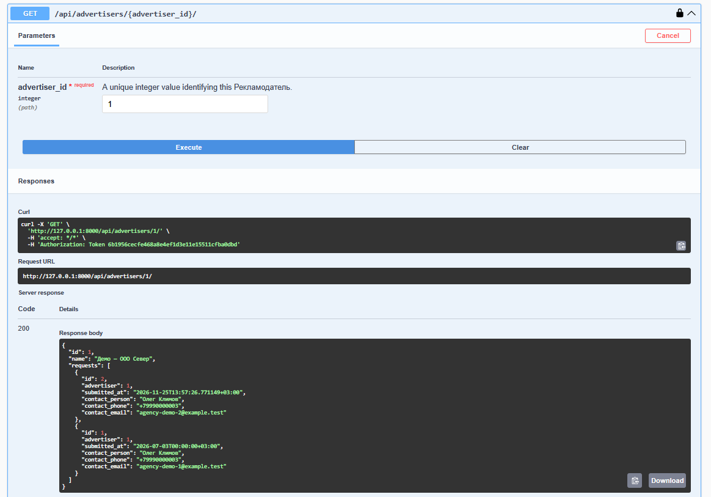
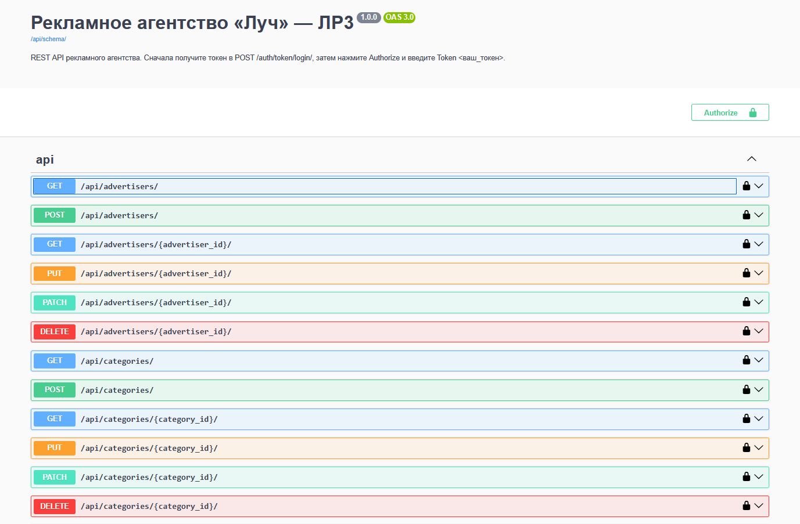
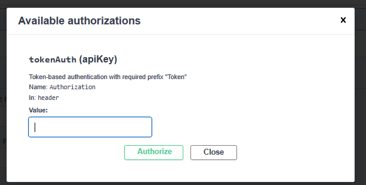
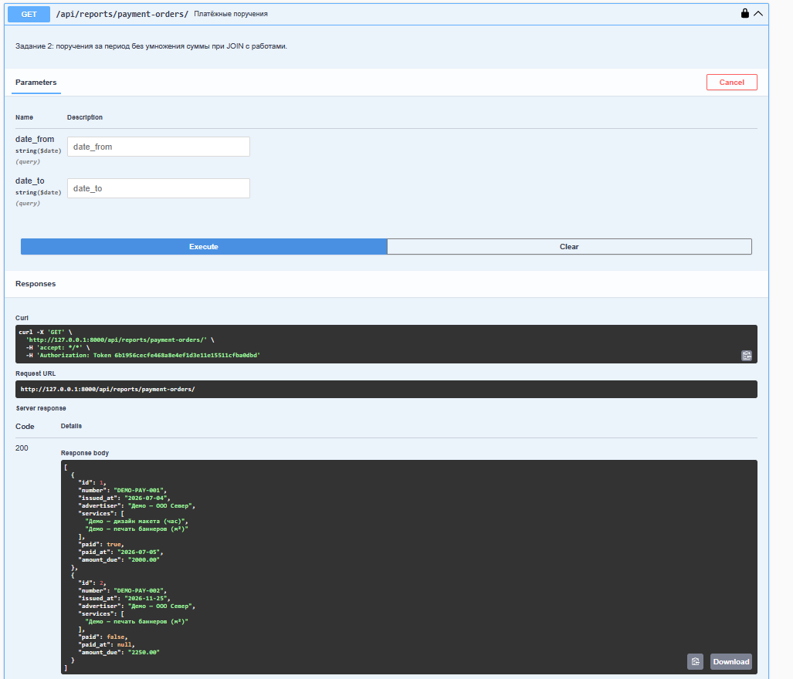
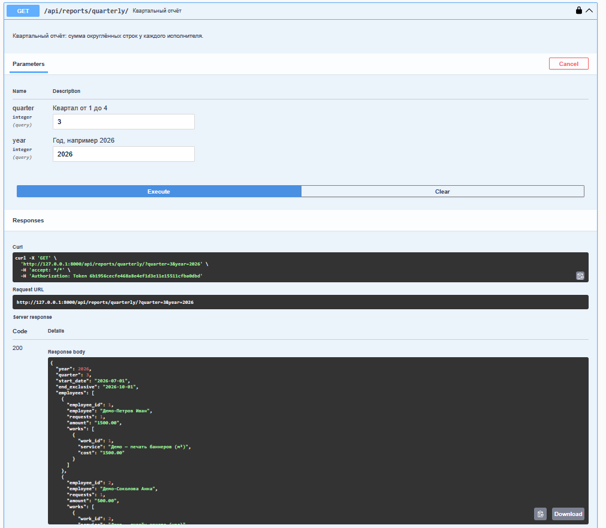
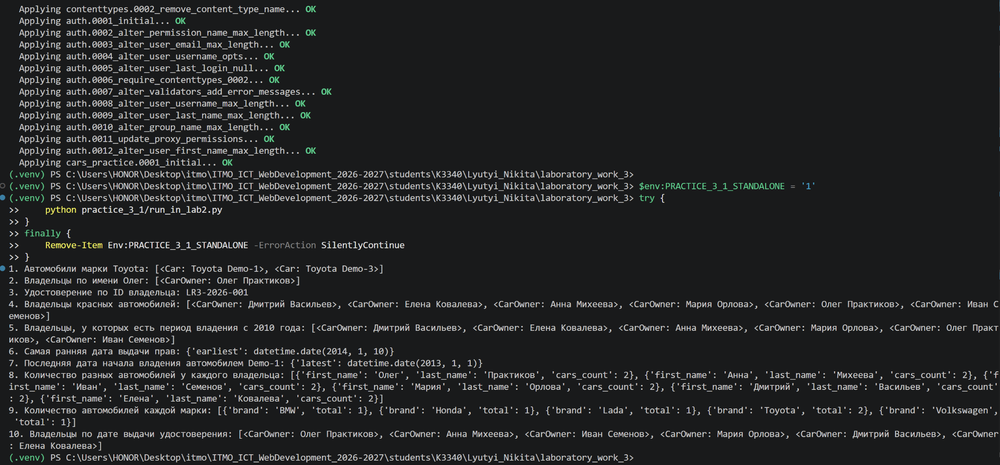
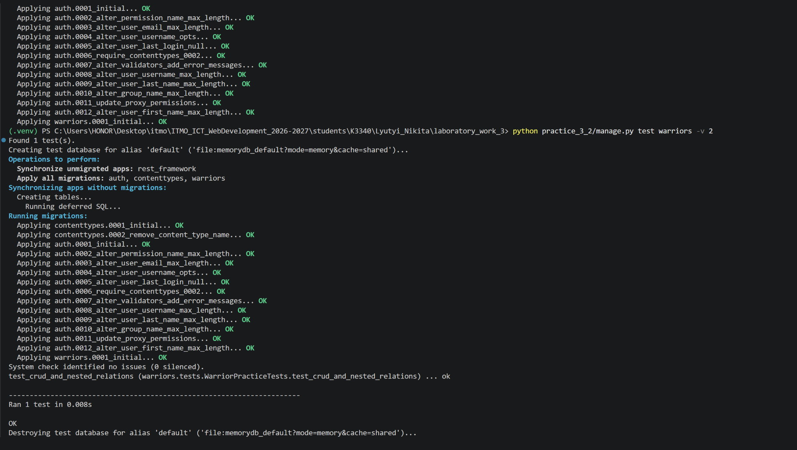
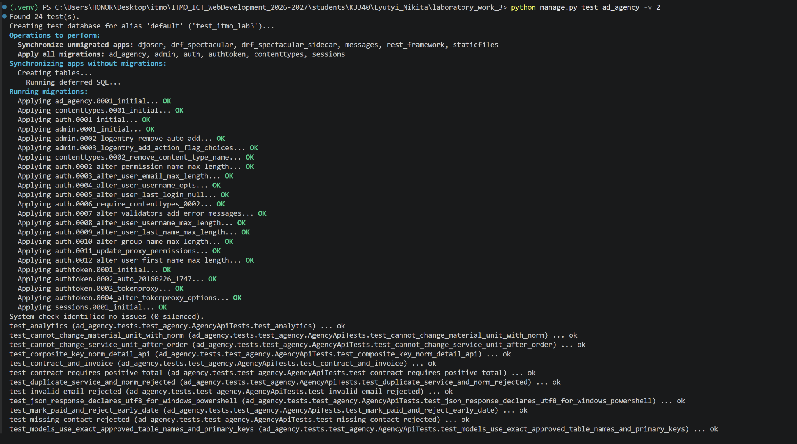

# Лабораторная работа №3. Разработка REST API рекламного агентства «Луч»

**Выполнил:** Лютый Никита, группа К3340, Университет ИТМО.  
**Вариант:** №8 — рекламное агентство «Луч».

## Цель работы

В рамках лабораторной работы я разработал серверную часть информационной системы рекламного агентства с использованием Django, Django REST Framework, Djoser и PostgreSQL. Сервис предназначен для учёта рекламодателей, заявок, услуг, исполнителей, материалов, договоров и платёжных поручений. Также реализованы REST API, проверка бизнес-правил и аналитические запросы по варианту задания.

## Используемые технологии

- **Python 3.13, Django 5.2** — серверное приложение, модели и запросы к базе данных;
- **Django REST Framework** — REST API, сериализаторы, представления и управление доступом;
- **Djoser и TokenAuthentication** — регистрация пользователей и авторизация по токенам;
- **PostgreSQL 16** — основная реляционная база данных;
- **Docker Compose** — локальный запуск PostgreSQL;
- **drf-spectacular и Swagger UI** — спецификация OpenAPI и интерактивная документация;
- **MkDocs Material** — документация лабораторных работ.

Для учебных практических заданий 3.1 и 3.2 дополнительно предусмотрены самостоятельные приложения на SQLite, независимые от основной PostgreSQL-базы.

## Архитектура приложения

Я разделил серверную часть на слои, каждый из которых выполняет определённую задачу:

```text
HTTP-клиент / Swagger UI
         |
         v
Django URL -> DRF Router / Djoser
         |
         v
ViewSet / APIView -> проверка прав
         |
         v
Serializer -> проверка и преобразование JSON
         |
         v
Сервисная логика -> транзакции, расчёты, ограничения
         |
         v
Django ORM -> PostgreSQL
```

В `agency/settings.py` находятся настройки Django, PostgreSQL и токенной авторизации, а в `agency/urls.py` — основные маршруты. Приложение `ad_agency` содержит модели данных, сериализаторы, обработчики запросов, расчёты и отчёты.

| Файл | Назначение |
|---|---|
| `ad_agency/models.py` | Десять предметных моделей, их поля, связи и ограничения |
| `ad_agency/serializers.py` | Проверка входящих данных, формирование JSON, вложенные объекты |
| `ad_agency/views.py` | CRUD-операции, оформление документов и отметка об оплате |
| `ad_agency/services.py` | Расчёт стоимости и межтабличные бизнес-проверки |
| `ad_agency/reports.py` | Пять запросов предметной области и квартальный отчёт |
| `ad_agency/permissions.py` | Проверка прав на чтение и изменение |
| `ad_agency/urls.py` | Маршруты API и отчётов |
| `ad_agency/report_schemas.py` | Описание структуры ответов аналитики для OpenAPI |
| `ad_agency/tests/test_agency.py` | Автоматические проверки основной лабораторной |
| `ad_agency/management/commands/seed_demo.py` | Демонстрационные данные |

## Модель данных

Модель из десяти таблиц была согласована с преподавателем до начала реализации.

| Таблица | Сведения |
|---|---|
| `advertiser` | Рекламодатель |
| `employee` | Исполнитель и его контактные данные |
| `service_category` | Категория рекламных услуг |
| `advertising_service` | Услуга, единица измерения, текущая цена |
| `material` | Материал и единица измерения |
| `material_usage_norm` | Норма расхода материала на единицу услуги |
| `advertising_request` | Заявка и контактные данные на дату её оформления |
| `request_work` | Конкретная работа, исполнитель, количество и согласованная цена |
| `contract` | Договор по заявке |
| `payment_order` | Платёжное поручение, сумма и дата оплаты |

**ER-диаграмма согласованной базы данных:**



Связи «один ко многим» представлены `ForeignKey`; например, один рекламодатель может иметь несколько заявок. Связи «один к одному» между заявкой и договором, а также между договором и платёжным поручением представлены `OneToOneField`. При этом договор и поручение могут отсутствовать у родительской записи.

Связь между рекламными услугами и материалами является отношением «многие ко многим». Я реализовал её через `ManyToManyField` с промежуточной моделью `MaterialUsageNorm`, поскольку у связи имеется собственный атрибут — норма расхода. Первичный ключ этой таблицы составной: `(service_id, material_id)`. Для этого использован `CompositePrimaryKey` из Django 5.2. У остальных предметных таблиц названия первичных ключей совпадают с согласованной ER-диаграммой.

Нормализация до третьей нормальной формы обеспечивается разделением справочников услуг, категорий и материалов, сохранением контактов в заявке и вынесением нормативов расхода в отдельную таблицу. В модели заданы внешние ключи, уникальные значения и проверки допустимых количеств и цен.

## Основные операции и бизнес-правила

В приложении реализованы создание, чтение, изменение и удаление записей с учётом ограничений предметной области. Для работы с API необходима токенная авторизация. Просматривать данные могут зарегистрированные пользователи; операции изменения разрешены пользователям с признаком `is_staff`.

Создание заказа включает выбор рекламодателя, оформление заявки с контактами, добавление работ с исполнителями и согласованными ценами. Договор заключается только по заявке, содержащей работы с положительной итоговой стоимостью. По договору оформляется не более одного платёжного поручения, а после подтверждения полной оплаты заказ считается выполненным.

Денежные суммы вычисляются с использованием `Decimal`. Сначала стоимость **каждой строки** округляется до копеек по обычному арифметическому правилу, затем округлённые значения суммируются. Поэтому платёжное поручение и аналитические отчёты используют одинаковый порядок расчётов. Бесплатные работы могут входить в платный заказ, но по полностью бесплатной заявке договор не создаётся.

После подписания договора состав работ, исполнители, количество и согласованные цены фиксируются. Для изменения условий создаётся новая заявка. При проверках используются транзакции `transaction.atomic()` и блокировки строк `select_for_update()`, чтобы связанные операции не противоречили друг другу при одновременных запросах.

## Реализованный REST API

Для каждой предметной сущности предусмотрены ресурсы API:

| Ресурс | URL |
|---|---|
| Рекламодатели | `/api/advertisers/` |
| Сотрудники | `/api/employees/` |
| Категории услуг | `/api/categories/` |
| Рекламные услуги | `/api/services/` |
| Материалы | `/api/materials/` |
| Нормы расхода | `/api/material-norms/` |
| Заявки | `/api/requests/` |
| Работы | `/api/works/` |
| Договоры | `/api/contracts/` |
| Платёжные поручения | `/api/payment-orders/` |

Для коллекций доступны методы `GET` и `POST`; для отдельной записи — `GET`, `PUT`, `PATCH` и `DELETE` в рамках разрешённых предметной областью операций. Отметка о полной оплате выполняется отдельным действием `POST /api/payment-orders/{id}/mark-paid/`.

**Вложенные объекты** реализованы для обоих типов связей, указанных в задании. Запрос `GET /api/advertisers/{id}/` содержит заявки рекламодателя (1:N). Запрос `GET /api/services/{id}/` возвращает материалы услуги и нормы их расхода (M:N).

На рисунке ниже показан результат запроса `GET /api/advertisers/1/`: в ответе с кодом `200 OK` рекламодатель содержит массив `requests` с двумя заявками и контактными данными, сохранёнными при оформлении.



Запрос `GET /api/services/1/` возвращает сведения об услуге, вложенный массив `materials` и нормы расхода `norms` с количеством материала на единицу услуги. Это подтверждает работу связи «многие ко многим» через промежуточную модель.


Для регистрации и авторизации используется Djoser: `POST /auth/users/`, `POST /auth/token/login/`, `GET /auth/users/me/`, `POST /auth/token/logout/`. Авторизованные запросы передают заголовок `Authorization: Token <токен>`.

### Интерактивная документация

Swagger UI доступен по адресу `/api/docs/`, а схема OpenAPI — по `/api/schema/`. В Swagger можно просматривать структуру запросов и ответов, передавать токен авторизации и запускать запросы непосредственно из браузера.

**Главная страница Swagger UI со списком CRUD-методов:**



**Окно токенной авторизации Swagger UI:**



## Аналитические запросы варианта №8

Я реализовал пять обязательных запросов и квартальный отчёт:

| URL | Результат |
|---|---|
| `/api/reports/completed-works/` | Выполненные работы: дата оплаты, рекламодатель, код услуги, исполнитель |
| `/api/reports/payment-orders/` | Поручения за период, услуги и статус оплаты |
| `/api/reports/services/` | Номенклатура услуг по категориям |
| `/api/reports/advertiser-requests/` | Заявки с заключёнными договорами за период |
| `/api/reports/employee-workload/` | Количество различных оплаченных заявок каждого сотрудника |
| `/api/reports/quarterly/` | Стоимость выполненных работ исполнителей за квартал |

Отбор оплаченных заказов производится по `payment_order.paid_at`, а поручений — по дате их выставления. Для подсчёта заявок сотрудников используется уникальный учёт идентификаторов заявок, чтобы несколько работ одного сотрудника не увеличивали их количество. Квартальный отчёт суммирует округлённые стоимости отдельных работ.

Работу аналитических запросов я проверил через Swagger UI. Например, `GET /api/reports/payment-orders/` вернул два поручения с разными состояниями: `paid: true` для оплаченного и `paid: false` для неоплаченного. В ответе также указаны заказчик, перечень услуг, даты и сумма.



Отчёт за III квартал 2026 года в демонстрационных данных показывает общую стоимость **2000,00 ₽**, в том числе 1500,00 ₽ у первого исполнителя и 500,00 ₽ у второго. Неоплаченное поручение в результат не включается. При запросе `GET /api/reports/quarterly/?year=2026&quarter=3` сервер вернул данные по двум исполнителям, включая их работы и рассчитанные суммы.



## Практическая работа 3.1 — запросы Django ORM

Практическую работу 3.1 я выполнил в `practice_3_1/`. В `run_in_lab2.py` приведено создание шести автовладельцев, шести автомобилей и водительских удостоверений, заполнение отношений владения, а также пять фильтрующих и пять агрегирующих запросов из методички. Использованы `filter()`, `get()`, `related_name`, `aggregate()`, `annotate()`, `Count()`, `Min()`, `Max()`, `order_by()` и `distinct()`.

Для работы с исходными моделями второй лабораторной предусмотрен режим интеграции с ЛР2. Отдельная копия автомобильных моделей в `cars_practice/models.py` позволяет выполнять эти запросы независимо, в учебной базе SQLite.

Я применил миграции практики 3.1 и запустил `run_in_lab2.py` в автономном режиме. Скрипт вывел все десять заданных выборок: автомобили марки Toyota, владельцев по имени и цвету автомобиля, удостоверение по идентификатору владельца, периоды владения, минимальную и максимальную даты, количество машин по владельцам и маркам и сортировку владельцев по дате выдачи удостоверений.



## Практическая работа 3.2 — Django REST Framework

Практическую работу 3.2 я выполнил в `practice_3_2/`. Это самостоятельное REST API для учёта воинов, профессий и навыков. Модели расположены в `warriors/models.py`, сериализаторы — в `warriors/serializers.py`, обработчики запросов — в `warriors/views.py`, маршруты — в `practice_urls.py`.

Для демонстрации разных способов создания API использованы `APIView`, стандартное обобщённое представление и `ModelViewSet`. Реализованы создание и получение навыков, получение воинов с вложенными профессиями и навыками, изменение данных воина и удаление. Поведение API проверяется тестами из `warriors/tests.py`. После применения миграций я выполнил команду `python practice_3_2/manage.py test warriors -v 2`: тест `test_crud_and_nested_relations` завершился успешно, итог — `Ran 1 test` и `OK`.



## Проверка основной лабораторной

В локальной среде Windows с PostgreSQL я создал и применил миграцию `ad_agency.0001_initial`. Проверка структуры БД подтвердила имена всех десяти предметных таблиц и первичных ключей, включая составной ключ таблицы норм расхода. `python manage.py check` завершилась без ошибок, а `makemigrations --check --dry-run` не обнаружила несохранённых изменений моделей.

Автоматический набор проверок основной лабораторной завершился успешно: **24 теста, результат `OK`**. Среди сценариев проверены авторизация через Djoser, вложенные связи 1:N и M:N, права доступа, ограничение цен и количеств, запрет изменения работ после подписания договора, расчёт стоимости и аналитические запросы.



Отдельно был выполнен HTTP smoke-тест через `scripts/smoke.ps1`: успешно прочитаны десять коллекций и шесть отчётов, проверены вложенные объекты, кодировка ответов UTF-8 и доступность Swagger. Сервер возвращает JSON с заголовком `Content-Type: application/json; charset=utf-8`.

## Вывод

В ходе лабораторной работы я реализовал серверную часть рекламного агентства «Луч» на Django REST Framework и PostgreSQL по согласованной модели из десяти таблиц. В приложении доступны операции учёта заявок, договоров и оплат, регистрация пользователей, вложенные отношения между сущностями и все аналитические запросы варианта №8. Для работы с API подготовлена интерактивная документация Swagger UI. В практических работах 3.1 и 3.2 рассмотрены запросы Django ORM и создание REST API разными способами. Работоспособность основной лабораторной подтверждена миграциями, автоматическими тестами и реальными HTTP-запросами.
